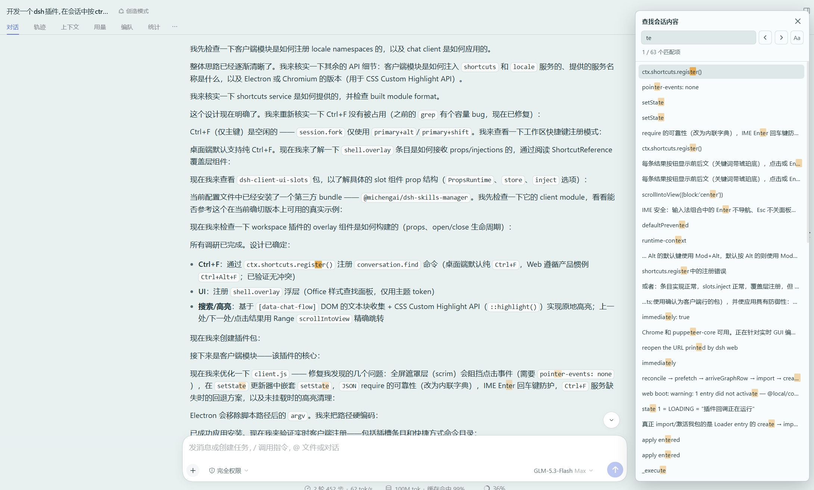

# dsh-conversation-search

Press <kbd>Ctrl</kbd>+<kbd>F</kbd> in a DeepSeek Harness session to search the conversation transcript.
An Office-style find panel lists every match with context; all matches are highlighted in the transcript,
and **Previous**, **Next**, or clicking a result jumps to that exact position and highlights it.

在会话中按 <kbd>Ctrl</kbd>+<kbd>F</kbd> 搜索 DeepSeek Harness 的会话内容：仿 Office 的查找面板列出全部
匹配项，所有匹配在原文处高亮，点击**上一处**、**下一处**或某条结果会精确滚动并高亮到对应位置。

## Features

- In-place highlighting of every match (CSS Custom Highlight API), with a stronger mark on the active match.
- Office-style panel: query input, Previous / Next, match-case toggle, position indicator (`3 / 27 matches`),
  and a result list showing the text around each hit.
- Exact navigation: Previous, Next, Enter / Shift+Enter, and clicking a result all scroll the transcript to the
  exact match and highlight it. Navigation wraps around both ends.
- IME-safe: composition Enter confirms input instead of navigating; Esc dismissal never closes the panel.
- Streaming-safe: a re-search never waits more than 700 ms even while the agent is still writing, and detached
  matches are skipped or recomputed instead of silently failing.
- Keyboard: <kbd>Enter</kbd> next, <kbd>Shift</kbd>+<kbd>Enter</kbd> previous, <kbd>Esc</kbd> closes, and focus
  returns to where it was.

## Install

In DeepSeek Harness: **Plugins** → **Add plugin**, and install from this repository
(`dsh plugin add shskyc/dsh-conversation-search` works from the CLI as well).

## Shortcut

| Shell | Default |
|---|---|
| Desktop (Windows / Linux) | <kbd>Ctrl</kbd>+<kbd>F</kbd> |
| Desktop (macOS) | <kbd>⌘</kbd><kbd>F</kbd> |
| Web (browser) | <kbd>Ctrl</kbd>+<kbd>Alt</kbd>+<kbd>F</kbd> (browser find keeps <kbd>Ctrl</kbd>+<kbd>F</kbd>) |

Rebind it anytime in **Settings → Shortcuts** (`conversation.find`). On Linux Web the command ships unbound
(the harness only accepts a fixed set of web bindings there) and can be assigned in the same place.

## Scope and limits

- Search covers text already loaded in the conversation view. Scroll history up (or click "Load earlier") to
  bring older turns in, then search again.
- Folded/collapsed subtrees (hidden tool details) are not searched until revealed.
- Matches beyond the first 500 are cut off with a visible "refine the query" hint.

## Compatibility

- Requires DeepSeek Harness `0.2.x` with the client-plugins runtime.
- Declares `@deepseek-ai/dsh-client-locale` and `@deepseek-ai/dsh-client-shortcuts` as its only client
  dependencies; no other harness internals are touched.

## License

[MIT](./LICENSE)
